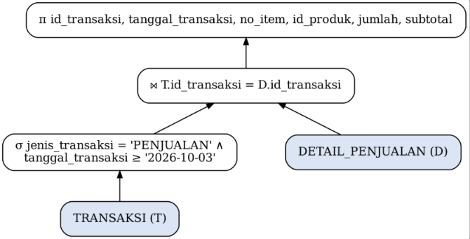
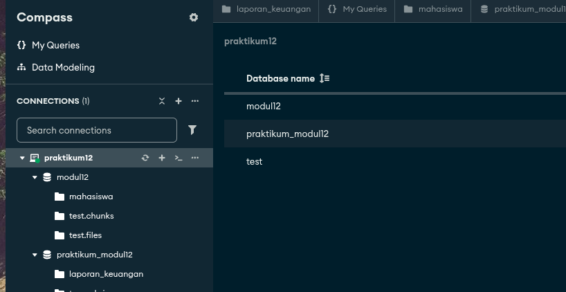
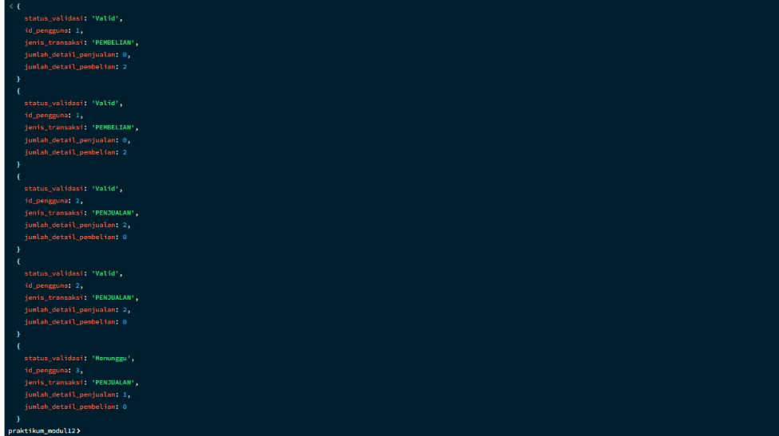
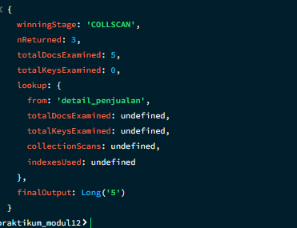
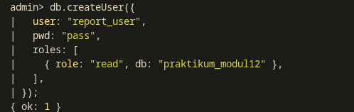

# Praktikum Basis Data - Modul 12
**Konsep Pemrosesan Query Basis Data (MongoDB)**

Repository ini berisi jawaban, skrip implementasi, serta dokumentasi untuk **[Modul 12: Konsep Pemrosesan Query Basis Data](https://prasetiyoutomo.notion.site/Modul-12-Konsep-Pemrosesan-Query-Basis-Data-41a33afba5e1804c8f7ad9335c2cd84c)** pada mata kuliah Basis Data menggunakan **MongoDB**.

---

## 📋 Deskripsi Modul
Modul ini berfokus pada pemahaman mendalam mengenai cara kerja DBMS memproses sebuah *query* di balik layar. Kegiatan utama dalam praktikum ini mencakup:
1. **Migrasi Data**: Pemindahan dan penyiapan dataset latihan serta rancangan migrasi untuk proyek (PJBL).
2. **Eksekusi Query Kompleks**: Pengujian *query* pada studi kasus sistem transportasi.
3. **Manajemen Hak Akses (DCL)**: Pembuatan *user*, pengaturan *roles/privileges*, serta pengujian hak akses (`read`, `delete`, dan `revoke`).
4. **Analisis Performa & Optimasi**: Inspeksi *execution plan*, perhitungan *query cost*, serta visualisasi *query tree*.

---

## 📁 Struktur Direktori

```text
Modul 12/
├── assets/
│   ├── create-user.png
│   ├── Hasil_inspeksi_execution_plan.png
│   ├── hasli_query_pengujian.png
│   ├── identifikasi_versi.png
│   ├── koneksi-client-dbx.png
│   ├── koneksi-client-compass.png
│   ├── query tree 1.png
│   ├── Query Tree 2.png
│   ├── status-hak-akses.png
│   ├── uji-hapus-data.png
│   ├── uji-izin-akses-gagal.png
│   ├── uji-objek-tidak-ditemukan.png
│   ├── uji-read-setelah-revoke.png
│   └── uji-read-user.png
├── diagram/
│   └── query_tree.png
├── dokumentasi/
│   ├── analisis_query_cost.pdf
│   └── laporan_modul12.pdf
├── scripts/
│   ├── 01_migrasi_data_latihan.js
│   ├── 02_query_pengujian.js
│   ├── 03_pengujian_dcl.js
│   └── 04_rancangan_migrasi.js
├── README.md
└── .gitattributes
```

---

## 📂 Rincian Isi Folder

### 1. [`dokumentasi/`](./dokumentasi)
Berisi dokumen laporan dan analisis dalam format PDF:
* **`analisis_query_cost.pdf`**: Hasil inspeksi dan analisis biaya eksekusi *query* (*execution plan*).
* **`laporan_modul12.pdf`**: Laporan lengkap seluruh tahapan pengerjaan Modul 12.

### 2. [`diagram/`](./diagram)
Berisi visualisasi alur pemrosesan *query*:
* **`query_tree.png`**: Diagram *query tree* yang menggambarkan tahapan operasi logis pada eksekusi *query*.

### 3. [`scripts/`](./scripts)
Berisi kumpulan skrip JavaScript (`mongosh`) yang digunakan selama praktikum:
* **`01_migrasi_data_latihan.js`**: Skrip untuk migrasi dan inisialisasi dataset latihan.
* **`02_query_pengujian.js`**: Skrip *query* pengujian untuk studi kasus dan inspeksi performa (`.explain()`).
* **`03_pengujian_dcl.js`**: Skrip manajemen *user*, pemberian hak akses (*grant*), pencabutan akses (*revoke*), dan skenario pengujian keamanan.
* **`04_rancangan_migrasi.js`**: Skrip rancangan migrasi basis data untuk kebutuhan PJBL.

### 4. [`assets/`](./assets)
Menyimpan seluruh tangkapan layar (*screenshot*) sebagai bukti pengerjaan, meliputi konfigurasi koneksi klien (MongoDB Compass / DBX), hasil eksekusi *query*, visualisasi *query tree*, hingga log pengujian hak akses (*DCL*).

---

## 🌳 Visualisasi Query Tree

### Diagram Query Tree Utama


### Visualisasi Query Tree Eksekusi

| Query Tree 1 | Query Tree 2 |
| :---: | :---: |
|  |  |

---

## 📸 Cuplikan Hasil Eksekusi

| Koneksi MongoDB Compass | Hasil Query Pengujian |
| :---: | :---: |
|  |  |

| Inspeksi Execution Plan | Pembuatan User & Hak Akses (DCL) |
| :---: | :---: |
|  |  |


## 🛠️ Teknologi yang Digunakan
* **DBMS**: MongoDB
* **Client Tools**: MongoDB Shell (`mongosh`) & MongoDB Compass
